# Panduan Lengkap Penggunaan iDesk — Portal Karyawan & User

Selamat datang di **Portal Layanan Mandiri iDesk Enterprise**. Dokumen ini dirancang sebagai panduan komprehensif bagi seluruh karyawan dan pengguna (**Role: USER / Client**) dalam memanfaatkan seluruh fitur layanan teknologi informasi, mulai dari proses autentikasi (login), pengelolaan tiket multi-divisi, interaksi chat langsung dengan teknisi, pemesanan ruang meeting Zoom, pengajuan E-Form akses sistem/VPN, hingga pusat bantuan mandiri (*Knowledge Base*).

---

## Daftar Isi Cepat
1. [Bab 1: Login & Akses Masuk Sistem](#bab-1-login--akses-masuk-sistem)
2. [Bab 2: Dashboard Tiket Saya (My Tickets)](#bab-2-dashboard-tiket-saya-my-tickets)
3. [Bab 3: Pembuatan Tiket Bantuan & Layanan](#bab-3-pembuatan-tiket-bantuan--layanan)
   - [3.1 Memilih Kategori Layanan](#31-memilih-kategori-layanan)
   - [3.2 Form Tiket IT Support Umum](#32-form-tiket-it-support-umum)
   - [3.3 Form Tiket Oracle K2, Web, & Mobile Dev](#33-form-tiket-oracle-k2-web--mobile-dev)
4. [Bab 4: Pelacakan Tiket, Chat Interaktif, & SLA](#bab-4-pelacakan-tiket-chat-interaktif--sla)
5. [Bab 5: Pemesanan Ruang Meeting Zoom (Zoom Calendar)](#bab-5-pemesanan-ruang-meeting-zoom-zoom-calendar)
6. [Bab 6: Pengajuan E-Form Akses Jaringan & Sistem](#bab-6-pengajuan-e-form-akses-jaringan--sistem)
   - [6.1 Memantau Status Pengajuan E-Form](#61-memantau-status-pengajuan-e-form)
   - [6.2 Mengisi Formulir Permintaan Akses Baru](#62-mengisi-formulir-permintaan-akses-baru)
7. [Bab 7: Pusat Bantuan & Solusi Mandiri (Knowledge Base)](#bab-7-pusat-bantuan--solusi-mandiri-knowledge-base)
8. [Bab 8: Notifikasi & Pengaturan Profil Pengguna](#bab-8-notifikasi--pengaturan-profil-pengguna)

---

## Bab 1: Login & Akses Masuk Sistem

Untuk mengakses portal iDesk, buka peramban web (*browser*) Anda dan kunjungi URL portal perusahaan: **`https://idesk.santos.co.id/login`**.

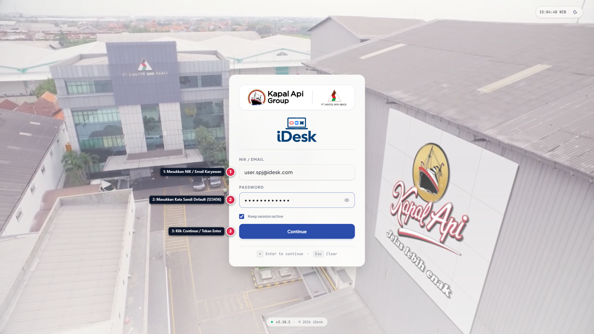

### Penjelasan Langkah-Langkah Login:
- **[1] NIK / Email Karyawan**: Ketik **NIK Karyawan** (Nomor Induk Karyawan) atau **Alamat Email Perusahaan** terdaftar pada kolom `NIK / EMAIL` (contoh: `user.spj@idesk.com`).
- **[2] Kata Sandi Default (123456)**: Masukkan kata sandi akun Anda pada kolom `PASSWORD`. Untuk login pertama kali, gunakan kata sandi default `123456`. Anda dapat menekan ikon mata (*eye icon*) untuk memeriksa ketepatan karakter kata sandi yang diketik.
- **[3] Tombol Continue / Tekan Enter**: Klik tombol **`Continue`** atau tekan tombol **`Enter`** pada keyboard Anda untuk langsung masuk ke portal. Centang opsi `Keep session active` jika menggunakan komputer kantor pribadi.

> [!TIP]
> **Pintasan Keyboard**: Tekan tombol `Enter` untuk langsung mengirim formulir login, atau tekan tombol `Esc` untuk mengosongkan seluruh kolom input dengan cepat.

---

## Bab 2: Dashboard Tiket Saya (My Tickets)

Setelah berhasil login, Anda akan langsung diarahkan ke halaman utama **My Tickets (`/client/my-tickets`)**. Halaman ini berfungsi sebagai pusat kontrol pemantauan seluruh riwayat dan status permintaan bantuan yang Anda ajukan.

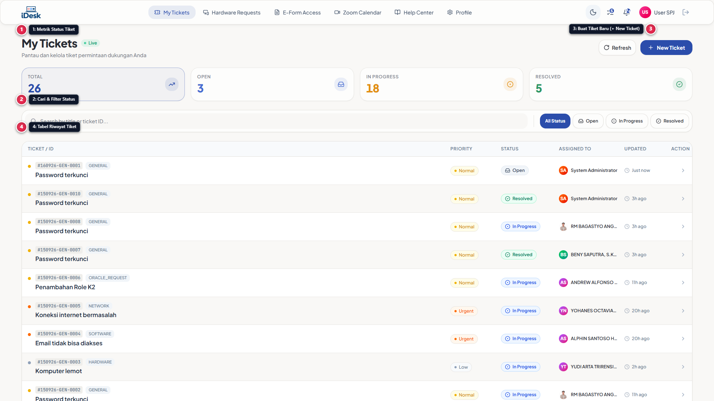

### Penjelasan Elemen Dashboard:
- **[1] Metrik Status Tiket**: Kartu ringkasan metrik real-time yang memuat:
  - **Total Tiket**: Akumulasi seluruh tiket yang pernah Anda buat.
  - **Open**: Tiket baru yang menunggu penugasan teknisi.
  - **In Progress**: Tiket yang sedang ditangani aktif oleh tim IT Support / Developer.
  - **Resolved**: Tiket yang telah selesai ditangani.
- **[2] Cari & Filter Status**: Kotak pencarian instan (*Search by title or ticket ID...*) untuk menemukan tiket berdasarkan judul kendala atau ID tiket (contoh: `#160926-GEN-0001`), dilengkapi tombol filter cepat (*All Status, Open, In Progress, Resolved*).
- **[3] Buat Tiket Baru (+ New Ticket)**: Tombol tindakan utama di sudut kanan atas untuk membuka katalog permohonan bantuan baru.
- **[4] Tabel Riwayat Tiket**: Daftar tabel riwayat tiket lengkap yang menampilkan nomor ID tiket, badge kategori, ringkasan masalah, tingkat prioritas, teknisi bertugas (*Assigned Agent*), dan waktu pembaruan terakhir. Klik pada baris mana pun untuk membuka halaman detail tiket dan ruang chat.

---

## Bab 3: Pembuatan Tiket Bantuan & Layanan

### 3.1 Memilih Kategori Layanan
Saat Anda menekan tombol **`+ New Ticket`**, Anda akan disajikan menu pilihan kategori layanan (**`/client/create`**). Sistem iDesk memisahkan alur tiket sesuai divisi spesialis agar masalah Anda ditangani oleh tim yang tepat secara cepat.

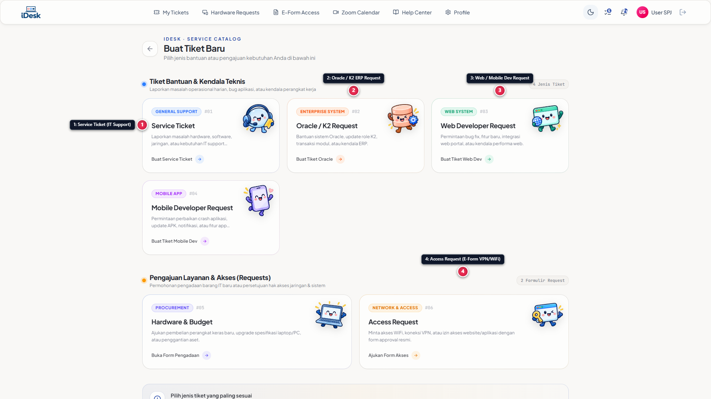

#### Penjelasan Kategori Layanan:
- **[1] Service Ticket (IT Support)**: Layanan IT kantor umum, mencakup permasalahan komputer, laptop, software standar, printer, email kantor, dan koneksi jaringan lokal.
- **[2] Oracle / K2 ERP Request**: Bantuan teknis modul sistem ERP Oracle EBS, update peran (*role*) approval K2 Workflow, maupun kendala validasi data transaksi bisnis.
- **[3] Web / Mobile Dev Request**: Permintaan perbaikan bug, penambahan fitur portal web internal perusahaan, atau kendala operasional aplikasi mobile Android/iOS.
- **[4] Access Request (E-Form VPN/WiFi)**: Permohonan izin akses akun VPN kantor, jaringan khusus, maupun sistem kerja terproteksi.

---

### 3.2 Form Tiket IT Support Umum
Jika Anda memilih kartu **Service Ticket**, Anda akan diarahkan ke formulir pembuatan tiket IT Support (**`/client/create?type=service`**).

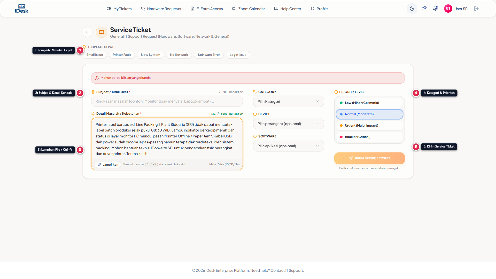

### Penjelasan Bagian Formulir:
- **[1] Template Masalah Cepat**: Tombol template siap pakai (*Email Issue, Printer Fault, Slow System, No Network, Software Error, Login Issue*) untuk mengisi format keluhan secara otomatis tanpa mengetik dari awal.
- **[2] Subjek & Detail Kendala**: Kolom isian untuk menguraikan permasalahan secara lengkap, lokasi kerja, pesan error yang tampil di layar, dan tindakan yang sudah dicoba. Subjek tiket akan di-generate otomatis oleh sistem.
- **[3] Lampiran File / Ctrl+V**: Tombol untuk melampirkan berkas atau cukup tekan kombinasi **`Ctrl + V`** pada keyboard untuk menempelkan screenshot error secara instan (mendukung hingga 5 berkas, maks. 10MB/file).
- **[4] Kategori & Prioritas**: Dropdown penentuan kategori (*Hardware, Software, Network, General*), spesifikasi perangkat/aplikasi terkait, dan tingkat prioritas (*Low, Normal, Urgent, Blocker*).
- **[5] Kirim Service Ticket**: Tombol konfirmasi untuk mengirimkan tiket permohonan langsung ke antrean teknisi IT Support on-site.

---

### 3.3 Form Tiket Oracle K2, Web, & Mobile Dev
Untuk kebutuhan sistem perusahaan atau pengembangan perangkat lunak, pilih kategori spesifik (**`/client/create?type=oracle-request`**).

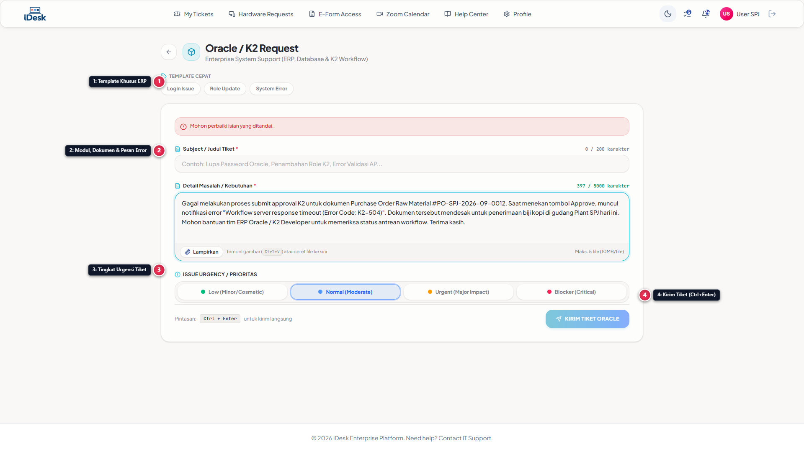

### Penjelasan Bagian Formulir Dev:
- **[1] Template Khusus ERP**: Pilihan template siap pakai modul enterprise seperti *Login Issue, Role Update, System Error, Sync Error*.
- **[2] Modul, Dokumen & Pesan Error**: Kolom untuk menguraikan modul sistem, nomor dokumen transaksi (contoh: *PO Raw Material #PO-SPJ-2026-09-0012*), dan kode error sistem (contoh: *Error Code K2-504*).
- **[3] Tingkat Urgensi Tiket**: Skala prioritas penanganan kendala (*Low, Normal, Urgent, Blocker*) berdasarkan dampak gangguan terhadap rantai pasok dan operasional pabrik/kantor.
- **[4] Kirim Tiket (Ctrl+Enter)**: Tombol pengiriman tiket dengan dukungan pintasan keyboard cepat **`Ctrl + Enter`** tanpa perlu menggerakkan kursor mouse.

---

## Bab 4: Pelacakan Tiket, Chat Interaktif, & SLA

Setelah tiket dikirim, Anda dapat memantau perkembangan penanganan secara real-time pada halaman **Ticket Detail (`/client/tickets/:id`)**.

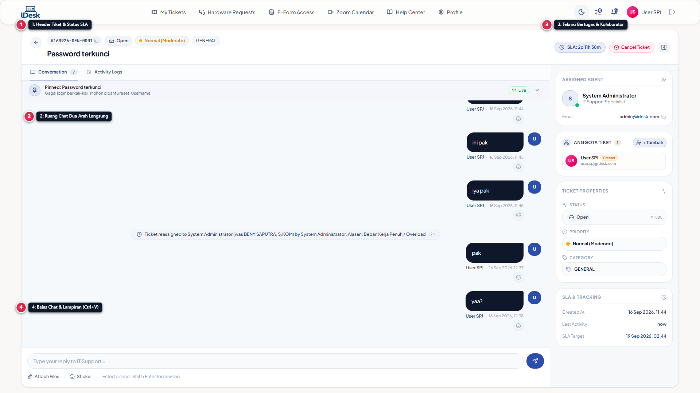

### Penjelasan Elemen Halaman Detail Tiket:
- **[1] Header Tiket & Status SLA**: Menampilkan nomor unik tiket, status saat ini, badge prioritas, dan **SLA Countdown Timer** yang menghitung mundur target respon dan penyelesaian tiket oleh tim IT.
- **[2] Ruang Chat Dua Arah Langsung**: Ruang percakapan interaktif langsung antara Anda dan teknisi penanggung jawab (*Assigned Agent*) untuk bertukar pesan, klarifikasi kendala, dan koordinasi perbaikan.
- **[3] Teknisi Bertugas & Kolaborator**: Panel informasi nama teknisi bertugas, rincian properti tiket, serta tombol **`+ Tambah`** untuk mengundang rekan kerja satu divisi agar dapat ikut memantau proses penanganan tiket.
- **[4] Balas Chat & Lampiran (Ctrl+V)**: Kolom pengetikan pesan balasan yang dilengkapi tombol lampiran berkas serta dukungan penempelan gambar screenshot langsung menggunakan pintasan **`Ctrl + V`**.

> [!IMPORTANT]
> **Rating Kepuasan Pengguna**: Ketika teknisi telah menyelesaikan masalah dan mengubah status tiket menjadi **Resolved**, jendela evaluasi bintang (*1-5 Stars Satisfaction Rating*) akan muncul. Berikan ulasan objektif Anda untuk membantu peningkatan kualitas layanan tim IT.

---

## Bab 5: Pemesanan Ruang Meeting Zoom (Zoom Calendar)

Portal iDesk menyediakan integrasi jadwal meeting virtual melalui menu **Zoom Calendar (`/client/zoom-calendar`)**. Fitur ini mempermudah pengguna membuat link meeting Zoom korporat resmi tanpa perlu mengelola lisensi akun secara manual.

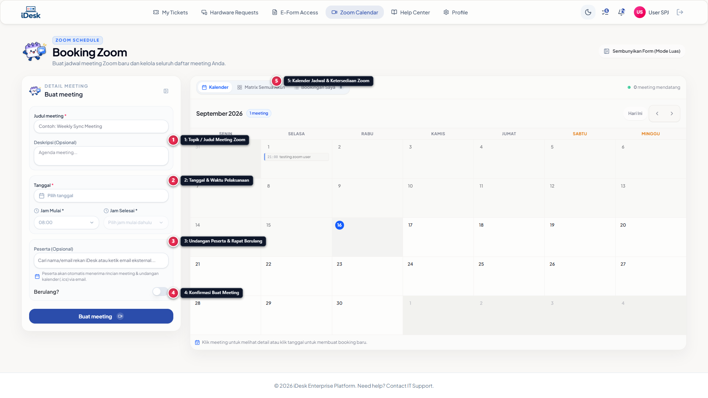

### Penjelasan 5 Langkah Pemesanan Ruang Zoom:
- **[1] Topik / Judul Meeting Zoom**: Masukkan agenda atau topik rapat pada kolom isian *Judul meeting* (contoh: *Weekly Sync Meeting - Operasional SPJ*).
- **[2] Tanggal & Waktu Pelaksanaan**: Tentukan tanggal rapat pada kalender, jam mulai meeting (interval per 15/30 menit), dan estimasi durasi rapat (contoh: 60 menit).
- **[3] Undangan Peserta & Rapat Berulang**: Masukkan email peserta rapat (opsional) dan aktifkan sakelar toggle **`Berulang?`** jika meeting diselenggarakan secara rutin berkala (misal: setiap 1 minggu).
- **[4] Konfirmasi Buat Meeting**: Tekan tombol **`Buat meeting`**. Sistem iDesk secara otomatis mengalokasikan lisensi Zoom korporat yang tersedia dan menghasilkan tautan *Join URL*, *Meeting ID*, serta *Passcode* secara instan.
- **[5] Kalender Jadwal & Ketersediaan Zoom**: Tampilan kalender interaktif untuk memantau slot waktu yang tersedia dan jadwal rapat yang telah diagendakan.

---

### Simulasi Formulir Pemesanan & Opsi Berulang (Recurring)

Berikut adalah contoh simulasi formulir pemesanan Zoom yang telah diisi lengkap dengan opsi jadwal berulang aktif serta sinkronisasi daftar meeting:

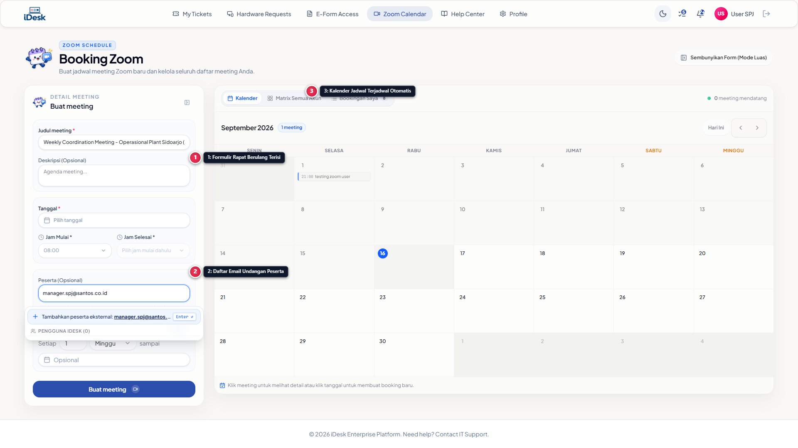

#### Catatan Simulasi & Fitur Tambahan:
- **[1] Formulir Rapat Berulang Terisi**: Contoh pengisian formulir meeting mingguan lengkap dengan rincian durasi dan tanggal berakhirnya jadwal berulang.
- **[2] Daftar Email Undangan Peserta**: Kolom penambahan email rekan kerja yang akan otomatis menerima undangan rapat dan kalender digital (.ics).
- **[3] Kalender Jadwal Terjadwal Otomatis**: Panel kalender kanan yang langsung memperbarui slot waktu rapat secara real-time.

---

## Bab 6: Pengajuan E-Form Akses Jaringan & Sistem

Untuk mematuhi tata kelola keamanan TI perusahaan, permintaan hak akses khusus (seperti VPN Kantor, akses jaringan departemen, atau sistem internal) dikelola melalui portal **E-Form Access (`/client/eform-access`)**.

### 6.1 Memantau Status Pengajuan E-Form
Halaman ini menampilkan seluruh formulir permohonan akses yang pernah Anda ajukan beserta status persetujuan atasan/ICT.

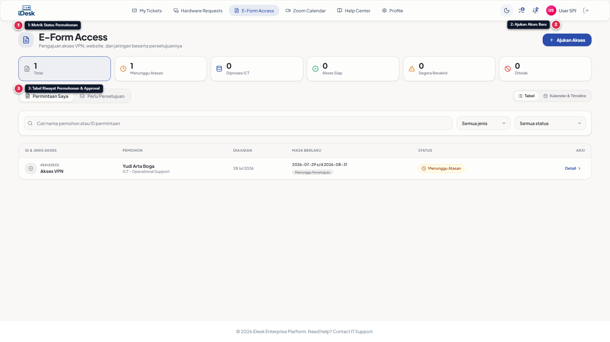

### Penjelasan Elemen Daftar E-Form:
- **[1] Metrik Status Permohonan**: Kartu pemantauan jumlah pengajuan: *Total Permohonan*, *Menunggu Atasan*, *Diproses ICT*, *Akses Siap*, dan *Ditolak*.
- **[2] Ajukan Akses Baru**: Tombol tindakan cepat di sudut kanan atas untuk membuka formulir permohonan izin akses baru.
- **[3] Tabel Riwayat Permohonan & Approval**: Tabel riwayat pengajuan lengkap dengan ID permohonan, jenis akses, nama pemohon, masa berlaku, dan status alur persetujuan (*Approval Status*).

---

### 6.2 Mengisi Formulir Permintaan Akses Baru
Halaman pengajuan akses baru (**`/client/eform-access/new`**) memiliki alur validasi formulir terstruktur.

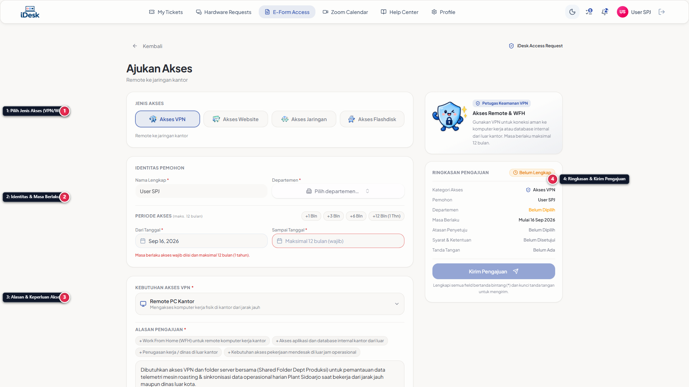

### Penjelasan Langkah Pengisian Formulir:
- **[1] Pilih Jenis Akses (VPN/Web)**: Pilih salah satu kartu akses yang dibutuhkan: *Akses VPN*, *Akses Website*, *Akses Jaringan*, atau *Akses Flashdisk*.
- **[2] Identitas & Masa Berlaku**: Data kepegawaian pemohon terisi otomatis. Tentukan rentang tanggal akses menggunakan tombol cepat: `+1 Bln`, `+3 Bln`, `+6 Bln`, atau `+12 Bln` (maksimal 12 bulan per pengajuan).
- **[3] Alasan & Keperluan Akses**: Pilih skenario kebutuhan (misal: *Remote PC Kantor*) dan uraikan alasan operasional secara jelas (misal: *Monitoring telemetri mesin roasting & sinkronisasi data operasional Plant Sidoarjo*).
- **[4] Ringkasan & Kirim Pengajuan**: Panel ringkasan data permohonan di sebelah kanan. Pastikan seluruh kolom bertanda bintang telah terisi, lalu klik **`Kirim Pengajuan`** untuk meneruskan form ke email Head of Department (HOD) Anda.

---

## Bab 7: Pusat Bantuan & Solusi Mandiri (Knowledge Base)

Sebelum membuat tiket baru, Anda sangat disarankan untuk mencari solusi cepat pada portal **Knowledge Base (`/client/kb`)**. Halaman ini memuat artikel panduan teknis resmi yang disusun oleh tim IT Support.

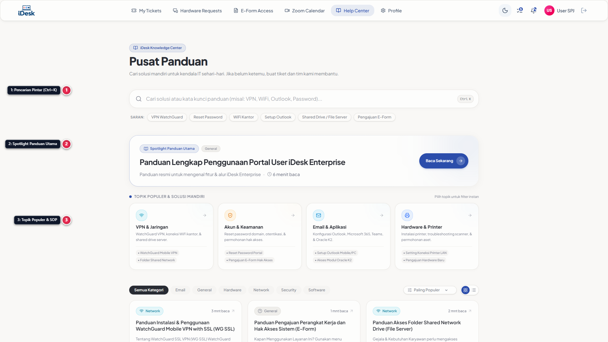

### Penjelasan Fitur Knowledge Base:
- **[1] Pencarian Pintar (Ctrl+K)**: Kotak penelusuran cepat dengan tombol pintasan `Ctrl + K`. Masukkan kata kunci kendala yang dihadapi (contoh: *wifi, vpn, printer, outlook, password*).
- **[2] Spotlight Panduan Utama**: Kartu sorotan panduan resmi terlengkap mengenai seluruh alur penggunaan portal iDesk Enterprise. Klik tombol **`Baca Sekarang`** untuk membuka artikel.
- **[3] Topik Populer & SOP**: Kartu akses cepat kategori kendala yang paling sering dicari (*VPN & Jaringan, Akun & Keamanan, Email & Aplikasi, Hardware & Printer*).

---

## Bab 8: Notifikasi & Pengaturan Profil Pengguna

Anda dapat mempersonalisasi akun dan memantau pembaruan tiket melalui halaman **Profile Settings (`/client/profile`)**.

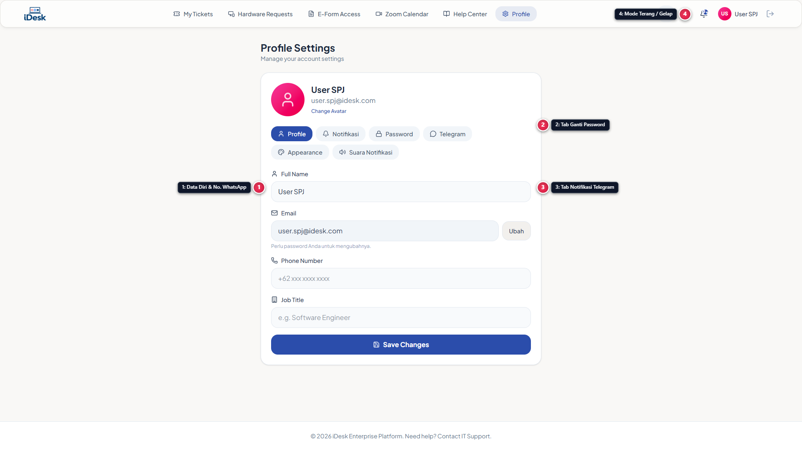

### Penjelasan Pengaturan Akun:
- **[1] Data Diri & No. WhatsApp**: Kolom data kepegawaian (Nama Lengkap, Email Kantor, Nomor Telepon, Jabatan). Perbarui nomor kontak WhatsApp aktif Anda agar teknisi dapat menghubungi Anda dengan cepat saat koordinasi perbaikan di lapangan.
- **[2] Tab Ganti Password**: Tab navigasi untuk mengganti kata sandi akun iDesk secara berkala demi menjaga keamanan data perusahaan.
- **[3] Mode Terang / Gelap**: Tombol pengalih tema tampilan antarmuka (*Light Mode / Dark Mode*) di bilah navigasi kanan atas untuk kenyamanan visual Anda.

---

## Butuh Bantuan Tambahan?
Jika Anda mengalami kendala yang tidak tercantum dalam panduan ini atau membutuhkan bantuan darurat (*Emergency IT Support*):
- **Portal Helpdesk**: [Buat Tiket Layanan di iDesk](https://idesk.santos.co.id/client/create)
- **Email IT Support**: `it.support@santos.co.id`
- **Operasional Layanan**: Senin – Jumat, 08:00 – 17:00 WIB

---
*Dokumentasi Resmi iDesk Enterprise Platform — PT Santos Jaya Abadi (Kapal Api Group)*  
*Versi: 3.18.2 — Terakhir Diperbarui: September 2026*
